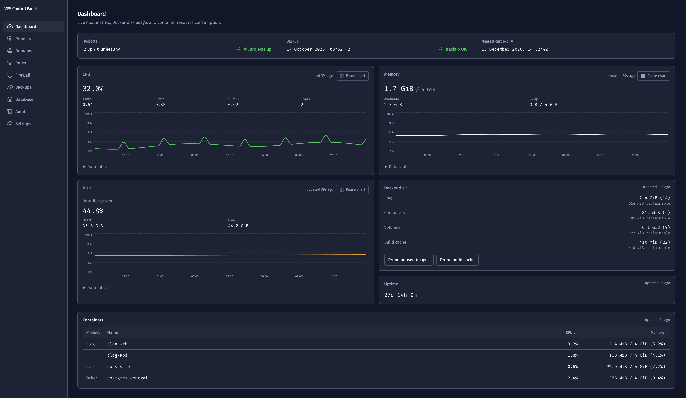

# vps-control-panel

Self-hosted control panel for a single Ubuntu VPS: central Postgres with GCS backups, per-project databases, nginx + TLS via Cloudflare, Docker Hub deploys, firewall, and resource monitoring.

[](https://github.com/andrewallkin/vps-control-panel/actions/workflows/ci.yml)
[](LICENSE)



## Features

- **Central Postgres** — one `postgres-central` container, with automatic backups to Google Cloud Storage
- **Per-project databases** — create, adopt, drop, and detach databases and roles; rotate and verify passwords
- **nginx + TLS via Cloudflare** — DNS-01 certificates with certbot, real client IPs from Cloudflare, automatic reload on renewal
- **Docker Hub deploys** — deploy and update projects from images
- **Firewall** — UFW locked down to SSH, HTTP, and HTTPS; Docker publishes to `127.0.0.1` only
- **Resource monitoring** — CPU, memory, disk, and swap at a glance
- **Audited agent API** — every mutating route is audited; long-running work returns a job you can poll or stream
- **SSH hardening** — optional one-prompt hardening (disable root login and password auth) during install

## Quick start

```bash
git clone https://github.com/andrewallkin/vps-control-panel.git
cd vps-control-panel
sudo ./install.sh
```

`install.sh` bootstraps a fresh Ubuntu 24.04 host (idempotent, safe to re-run): it installs Docker, nginx, certbot (Cloudflare DNS plugin), and UFW; adds swap; installs the agent; and starts the central Postgres stack. When it finishes it prints SSH tunnel instructions — open the tunnel, then visit `http://localhost:8080`.

### Requirements

- A VPS (or any machine) running Ubuntu 24.04 with root access
- A Cloudflare account and API token for DNS-01 certificates
- A Google Cloud service account for GCS backups

## Updating

```bash
sudo ./update.sh --pull
```

In-place upgrade for an existing install: pulls the latest code, snapshots the panel DB and central Postgres, and rebuilds the stack. Safe to re-run; omit `--pull` to re-apply the current checkout.

## How it works

```
browser ──ssh tunnel──▶ panel (API + UI, port 8080)
                          │
                          ▼  unix socket (/run/vpscp/agent.sock)
                       agent (root systemd service)
                          │
                          ▼
              host: postgres, nginx, ufw, docker, backups
```

- `agent/` — privileged host agent (root systemd service on a unix socket). Owns the host: databases, nginx, firewall, backups, monitoring.
- `panel/` — web UI and API. Talks to the agent over the unix socket; never touches the host directly.
- `stack/` — central Postgres (`postgres-central`) and the GCS backup container.
- `install.sh` / `update.sh` — bootstrap and in-place upgrade.

For moving an existing VPS workload onto a fresh panel install, see [docs/migration.md](docs/migration.md).

## Agent API

Mutating routes are audited; long-running work returns a `job_id` (poll or stream via `/v1/jobs`).

| Area      | Routes |
|-----------|--------|
| Jobs      | `/v1/jobs` — list, status, event stream |
| Database  | `/v1/db` — list, create, adopt, drop, detach; rotate/verify passwords; per-slug dumps |
| Restore   | `/v1/restore/uploads`, `/v1/restore/run` — chunked upload, status, restore from dump |
| Backup    | `/v1/backup/settings`, `/v1/backup/test`, `/v1/backup/run-now`, `/v1/backup/status` |

## Development

```bash
# agent
cd agent
uv sync
uv run pytest
uv run ruff format . && uv run ruff check .

# panel backend
cd panel/backend
uv run pytest

# panel frontend
cd panel/frontend
npm test
```

## License

Released under the [GNU AGPL v3.0](LICENSE).

- **Self-hosting, personal use, internal business use:** free, including commercial use.
- **Offering this panel as a hosted service (or redistributing it in a closed-source product):** AGPL requires you to release your source. If that doesn't work for you, a commercial license is available — open an issue or email the address on [my GitHub profile](https://github.com/andrewallkin).

As copyright holder I also license the code directly to customers under custom terms.
